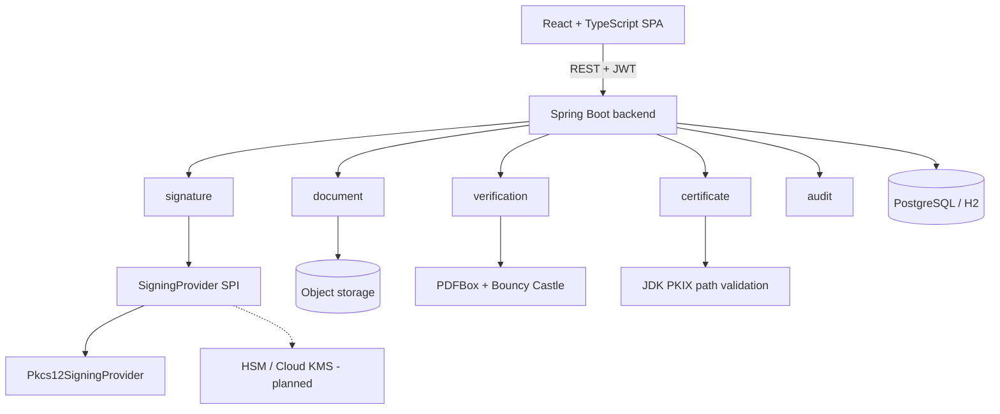

# DocuTrust

**Digital Signature, Document Integrity & Tamper Detection Platform**

DocuTrust applies real PAdES digital signatures to PDFs and proves, cryptographically,
whether a document has been altered since it was signed.

> It does not trust a document because it looks genuine. It proves whether the signed
> content *is* genuine.

---

## The problem

You receive an employment contract as a PDF. It states a salary of ₹800,000.

How do you know:

- it really came from the company that appears to have sent it?
- the figure has not been changed in transit?
- the person who signed it was who they claim to be?

A PDF is a file. Anyone can open it in an editor and change a number. Nothing about a
document's appearance distinguishes an authentic one from a forgery — a convincing fake
looks exactly like the real thing, because looking real is the entire goal of a forgery.

## The solution

A digital signature binds a document's *exact bytes* to a private key held by an
identified signer. Change one byte and the signature stops verifying. DocuTrust
implements this end to end: signing, verification, certificate and trust-chain
evaluation, tamper classification, and a tamper-evident audit log.

The central demonstration:

```
Original PDF  →  Sign  →  Verify: AUTHENTIC
                            ↓
                   Change "800,000" to "900,000"
                            ↓
                      Verify: TAMPERING DETECTED
```

In that second verification the **certificate is still reported as valid**. The
certificate did not change — the document did. Conflating those two is a common and
actively misleading bug, and DocuTrust is built to keep them separate.

---

## What makes this more than a "Sign" button

Three principles run through the whole codebase.

**1. Verification is cryptographic, not bookkeeping.**
Nothing in the database decides whether a signature is valid. Verification recomputes a
digest over the exact byte range the signature covers and compares it with the digest
sealed inside the signature. A document DocuTrust has never seen verifies just as well
as one it signed, and any conformant validator would reach the same answer.

**2. Unknown is never rendered as safe.**
No RFC 3161 timestamp authority is configured, so timestamp status reports
`NOT_AVAILABLE` — never `VALID`. Revocation checking is off, so it reports `NOT_CHECKED`
— never `GOOD`. This is enforced in the type system, in the API, and in the frontend, and
it is covered by tests that fail if a status is ever painted green when it should not be.

**3. There are three answers, not two.**

| Verdict | Meaning |
|---|---|
| 🟢 **VALID** | Signature verifies, content unchanged, chain reaches a configured trust anchor |
| 🟡 **VALID_UNTRUSTED** | Cryptography is sound and content is unchanged, but the signer chains to nobody we trust |
| 🔴 **TAMPERED / INVALID** | Content changed after signing, or the signature fails verification |

The amber state exists because collapsing "mathematically valid but untrusted" into
either green or red is a lie in both directions.

---

## Architecture

A modular monolith: one Spring Boot process, partitioned into feature modules with real
boundaries. See [ADR-001](docs/ADR/ADR-001-modular-monolith.md).



### How tamper detection actually works

A PDF signature reserves a hole for itself and declares a `/ByteRange` covering
everything else in the file:

```
[ ... PDF content ... ][ signature hole ][ ... PDF content ... ]
|<------- signed ----->|   not signed    |<------- signed ----->|
```

The digest is computed over the concatenation of those two spans. Changing a single byte
anywhere in the covered range produces a completely different digest, and verification
fails. That is proof, not inference — and it is why DocuTrust reports *that* content
changed but never claims to know *which words* changed, which would require an original
it does not have.

Full detail in [docs/CRYPTOGRAPHY.md](docs/CRYPTOGRAPHY.md); the underlying mathematics,
including the SHA-256 round function and the ECDSA correctness proof, is in
[docs/CRYPTOGRAPHIC_MATHEMATICS.md](docs/CRYPTOGRAPHIC_MATHEMATICS.md).

---

## Technology

**Backend** — Java 21, Spring Boot 3.5.3, Spring Security, Spring Data JPA, Flyway,
PostgreSQL (H2 locally), Apache PDFBox 3.0.7, Bouncy Castle 1.80, springdoc-openapi,
Micrometer, JUnit 5 + AssertJ.

**Frontend** — React 19, TypeScript (strict), Vite 7, Material UI 7, TanStack Query,
Axios, Recharts, Vitest + Testing Library.

No cryptographic primitive is implemented in this repository. RSA, ECDSA, SHA-256, ASN.1,
CMS, X.509 parsing and PKIX path validation all come from Bouncy Castle, Apache PDFBox and
the JDK. See [ADR-007](docs/ADR/ADR-007-no-custom-cryptography.md).

---

## Quick start

### Without Docker (fastest, and how this build was verified)

The default `local` profile uses in-memory H2 and filesystem storage, so no external
service is required.

Requirements: JDK 21, Maven 3.9+, Node 20+.

```bash
cp .env.example .env     # then edit the CHANGE_ME values
```

Terminal 1 — backend:

```bash
cd backend && mvn spring-boot:run
```

Terminal 2 — frontend:

```bash
cd frontend && npm install && npm run dev
```

Open http://localhost:5173.

Demo credentials come from `.env` (`DOCUTRUST_DEMO_USER_PASSWORD`). If unset, a random
password is generated and printed once to the backend startup log — no password is ever
hardcoded in source.

On first run the backend generates an ephemeral development PKI and says so loudly. The
keys are real; they simply carry no external trust and are regenerated on restart.

### With Docker

```bash
cp .env.example .env
docker compose up -d
```

Brings up PostgreSQL, MinIO, the backend and the frontend.
See [Known limitations](#known-limitations) — the compose stack has not been executed in
this environment, because Docker is not installed on the machine this was built on.

### Windows

The `Makefile` bodies are POSIX shell; run them under Git Bash or WSL. Native PowerShell
equivalents:

```powershell
cd backend;  mvn spring-boot:run
cd frontend; npm run dev
.\scripts\demo-flow.ps1          # full upload → sign → verify → tamper demo
```

---

## Demo

With the backend running, this drives the entire flow and prints what actually happened:

```bash
DOCUTRUST_DEMO_USER_PASSWORD='...' powershell -File scripts/demo-flow.ps1
```

Real output from this build:

```
5. Verifying the untouched signed document
  Verdict     : VALID
  Integrity   : INTACT
  Signature   : VALID
  Certificate : VALID
  Chain       : TRUSTED
  Revocation  : NOT_CHECKED
  Timestamp   : NOT_AVAILABLE
  ByteRange   : 0, 1610, 34380, 779

6. Altering the salary in the signed PDF, then verifying again
  Changed 'INR 800,000' to 'INR 900,000' at byte offset 448
  File size is unchanged: 35159 bytes

  Verdict     : TAMPERED
  Integrity   : MODIFIED
  Signature   : INVALID
  Certificate : VALID          ← the certificate is fine; the document changed
  Chain       : TRUSTED
  Class       : SIGNED_CONTENT_CHANGED
  Proven      : True
```

The tampered file is byte-for-byte the same length and still a structurally valid PDF that
any reader will open. It fails verification purely because the signed bytes changed.

A presenter's script is in [docs/DEMO_SCRIPT.md](docs/DEMO_SCRIPT.md).

---

## Testing

```bash
make test            # everything
make backend-test    # 60 backend tests
make frontend-test   # 23 frontend tests
make security-test   # the attack simulation suite alone
```

### Attack simulation suite

Twelve scenarios construct genuinely hostile artefacts and run them through the same code
the API uses. The summary below is printed by the suite itself from what it observed — it
is not a hardcoded table:

```
  Valid PDF signature                          PASS
  Modified signed content                      DETECTED
  Signature corruption                         DETECTED
  Untrusted certificate                        DETECTED (amber)
  Expired certificate                          DETECTED
  Certificate outside validity window          DETECTED
  Wrong signing certificate                    DETECTED
  Unsigned document                            DETECTED
  Malformed document                           DETECTED
  Page appended via full rewrite               DETECTED
  Second signature preserves the first         PASS (2 valid signatures)
  Post-signature revision classified honestly  PASS
```

The last two matter as much as the failures. Adding a second signature must *not* break
the first, and appending a revision is normal PDF behaviour that must be surfaced without
being called tampering.

---

## Security model

- **Trust is explicit.** Certificates embedded in a submitted PDF are treated as claims,
  never as trust anchors. Trust comes only from a configured trust store — otherwise a
  forger who controls the document also controls the chain that "validates" it.
- **Upload validation** by magic bytes and a structural parse, not the client's
  `Content-Type`; filenames are sanitised before they reach storage or headers.
- **Authentication** via JWT with BCrypt (strength 12) password hashing; roles are
  `USER`, `VERIFIER`, `ADMIN`, enforced server-side.
- **No secrets in source.** Every credential comes from the environment; `.gitignore`
  blocks `*.p12`, `*.key`, `*.pem`, `.env` and generated key material.
- **Nothing sensitive is logged** — no keys, passwords, tokens, `Authorization` headers
  or document contents.
- **Audit log is hash-chained** so retroactive edits are detectable.
- **Rate limited** with token buckets: logins throttled per source address (credential
  stuffing spreads across accounts, so the limit has to bind to network origin), signing
  and verification throttled per account (that work is attributable to a user). Refusals
  return `429` with `Retry-After`.

Full analysis in [docs/THREAT_MODEL.md](docs/THREAT_MODEL.md) (STRIDE) and
[docs/SECURITY.md](docs/SECURITY.md).

---

## API

OpenAPI UI at http://localhost:8080/swagger-ui.html while the backend runs.

```
POST   /api/v1/auth/login
POST   /api/v1/documents                  upload
GET    /api/v1/documents
GET    /api/v1/documents/{id}
POST   /api/v1/documents/{id}/sign
GET    /api/v1/documents/{id}/download
GET    /api/v1/documents/{id}/versions
GET    /api/v1/documents/{id}/signatures
GET    /api/v1/documents/{id}/audit
POST   /api/v1/verification               verify any PDF
GET    /api/v1/verification/{id}
GET    /api/v1/certificates
GET    /api/v1/dashboard/summary
GET    /api/v1/admin/audit/integrity      ADMIN
```

---

## Known limitations

Stated plainly, because a security tool that overstates what it does is worse than one
that does less.

**Not implemented in this build:**

| Area | Status |
|---|---|
| MinIO object storage | Interface and compose service exist; `MinioDocumentStorage` is **not implemented**. Selecting it fails loudly at startup rather than writing documents somewhere unexpected. Filesystem storage is used. |
| RFC 3161 timestamp *creation* | `TimestampService` abstraction and `NoOpTimestampService` exist; there is no TSA client, so signatures are B-B. Verification *does* inspect submitted documents for a token and reports what it finds. |
| OCSP / CRL revocation | Interface exists; only `DisabledRevocationService`. Status always reports `NOT_CHECKED`. |
| Custom signature appearance | The visible block is implemented with a fixed layout at bottom-right of the last page. Placement and styling are not configurable. |
| PDF verification report | HTML and JSON export are implemented; PDF export is not. |
| SoftHSM, AWS/Azure/GCP KMS, India eSign | Extension points only — deliberately not stubbed to look functional. |
| Testcontainers integration tests | Dependencies are declared; no container-backed tests written (Docker unavailable here). |
| Prometheus / Grafana dashboards | Actuator exposes Prometheus metrics; no dashboards provisioned. |
| Distributed rate limiting | Implemented, but in-memory and therefore per-instance. A shared store is needed before horizontal scaling. |

**Not verified in this environment:** Docker is not installed on the machine this was
built on, so `docker compose up` and both Dockerfiles have **never been executed**. They
are written carefully but should be treated as untested until someone runs them.

**Inherent limitations:**

- Without a trusted timestamp, DocuTrust cannot prove *when* a document was signed. The
  signer's claimed signing time is an unverified assertion, and the UI says so.
- The audit chain is tamper-*evident*, not tamper-*proof*. An attacker with full database
  write access could recompute it. Publishing chain-head digests externally would close
  that gap; it is not implemented.
- The audit append lock is per-JVM, correct for a single instance. Multi-instance
  deployment needs database-level serialisation.
- A valid signature proves a document is unchanged. It says nothing about whether its
  contents are *true*.

---

## Disclaimer

This project demonstrates standards-based digital signing and verification. It is **not**
a legally recognised eSignature service.

Production, legally recognised signing generally requires approved certificate providers,
jurisdiction-specific compliance, qualified trust services, certified HSMs, organisational
PKI policy, and licensed eSign providers where applicable. DocuTrust makes no claim to any
of these.

The development PKI is generated locally, carries no external trust, and must never be
used to sign anything of legal or commercial value.

---

## Documentation

| Document | Contents |
|---|---|
| [ARCHITECTURE.md](docs/ARCHITECTURE.md) | Module map, signing and verification paths, trust model |
| [CRYPTOGRAPHY.md](docs/CRYPTOGRAPHY.md) | Hashing, signing, verification, PKI, PAdES explained |
| [CRYPTOGRAPHIC_MATHEMATICS.md](docs/CRYPTOGRAPHIC_MATHEMATICS.md) | Every formula: SHA-256 rounds, RSA, ECDSA, CMS, chain validation |
| [THREAT_MODEL.md](docs/THREAT_MODEL.md) | STRIDE analysis with mitigations and residual risk |
| [SECURITY.md](docs/SECURITY.md) | Controls, CSRF reasoning, logging policy |
| [API.md](docs/API.md) | Endpoints, payloads, status unions, error codes |
| [DEMO_SCRIPT.md](docs/DEMO_SCRIPT.md) | 5–8 minute presentation walkthrough |
| [KMS_INTEGRATION.md](docs/KMS_INTEGRATION.md) | How HSM/KMS providers would plug in |
| [ADR/](docs/ADR/) | Architecture decision records |
| [IMPLEMENTATION_SUMMARY.md](IMPLEMENTATION_SUMMARY.md) | What was built, test results, limitations |
| [INTERVIEW_GUIDE.md](INTERVIEW_GUIDE.md) | Answers to the questions this project invites |
