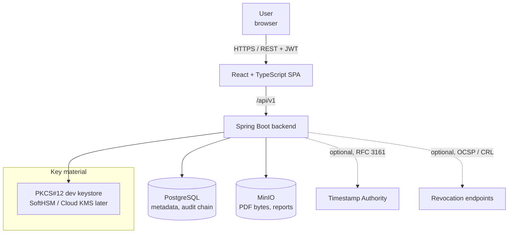
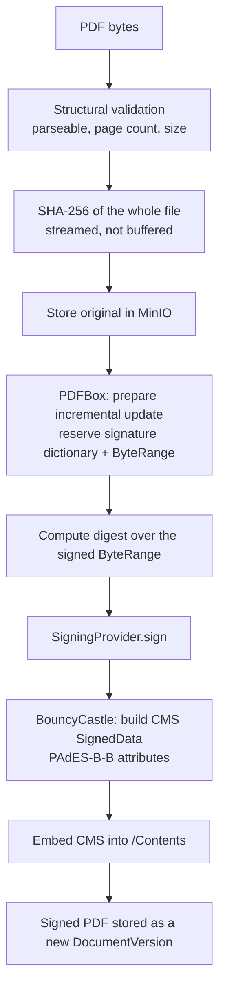
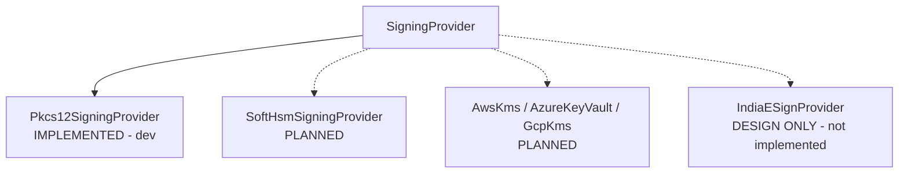
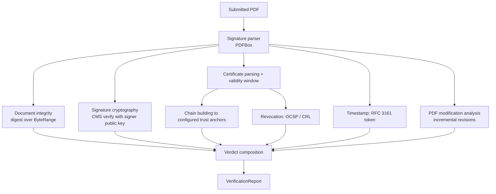

# DocuTrust — Architecture

> Enterprise Digital Signature, Document Integrity & Tamper Detection Platform

This document describes the structure of the system, why it is shaped that way,
and where the boundaries are. It is written for engineers who will extend the
system and for reviewers who need to judge whether the security claims hold.

---

## 1. Architectural style: modular monolith

DocuTrust is a **modular monolith**. One deployable Spring Boot process,
internally partitioned into feature modules with explicit boundaries.

This is a deliberate choice, not a default. See
[ADR-001](ADR/ADR-001-modular-monolith.md).

The short version: the hard problems in this system are *cryptographic
correctness* and *trust evaluation*, not horizontal scale. Distributing the
system across services would add network partitions, distributed transactions
and deployment complexity while making the security-critical paths harder to
reason about and harder to test end-to-end. The module boundaries are real, so
extraction later is a refactor rather than a rewrite.

---

## 2. System context



Dotted edges are **optional integrations**. When they are absent the system
reports `NOT_AVAILABLE` / `NOT_CHECKED`. It never substitutes a fabricated
success. This is the single most important behavioural rule in the codebase.

---

## 3. Module map

Packages are organised by **feature**, not by technical layer. There is no
global `controller/`, `service/`, `repository/` triad.

```
com.docutrust
│
├── common          Cross-cutting: error model, correlation IDs, value objects
├── security        Authentication, JWT, roles, method authorisation
├── storage         DocumentStorage abstraction + MinIO implementation
│
├── document        Upload, metadata, SHA-256, versions
│   ├── api             REST controllers + DTOs
│   ├── application     Use-case services, transaction boundaries
│   ├── domain          Entities, value objects, domain enums, ports
│   └── infrastructure  JPA adapters, PDF inspection
│
├── signature       PAdES signing
│   ├── api
│   ├── application
│   ├── domain          SigningProvider SPI, SignRequest / SignResult
│   └── infrastructure  Pkcs12SigningProvider, PDFBox + BouncyCastle glue
│
├── verification    The trust engine
│   ├── api
│   ├── application     Orchestrates the independent checks
│   ├── domain          VerificationReport and its sub-results
│   └── infrastructure  Signature parsing, tamper analysis
│
├── certificate     X.509 parsing, chain building, trust anchors, revocation
├── timestamp       TimestampService SPI (NoOp / RFC 3161)
└── audit           Hash-chained tamper-evident audit log
```

Each feature module exposes a narrow application-service API. Modules do not
reach into each other's `domain` or `infrastructure` packages.

---

## 4. The signing path



Critical property: the digest is computed over the PDF's **signed ByteRange** —
the entire file except the hole reserved for the signature itself. Any change
to a single byte inside that range changes the digest and breaks verification.
That is what makes tamper detection cryptographic rather than heuristic.

### Signing provider abstraction

The business layer depends on an interface, never on PKCS#12:

```java
public interface SigningProvider {
    SignResult sign(SignRequest request);
    String providerName();
}
```



Only the solid edge exists today. The dotted ones are extension points with
documented contracts — they are **not** stubs that pretend to work.

---

## 5. The verification path

Verification is the heart of the product. It runs a set of **independent**
checks and composes them into a verdict. Independence matters: a tampered
document must not be reported as having an invalid *certificate*, because the
certificate is fine — it is the document that changed.



### Verdict composition

Three outcomes are visually and semantically distinct:

| Verdict | Meaning |
|---|---|
| **VALID** (green) | Signature verifies, content unchanged, chain reaches a configured trust anchor |
| **VALID_UNTRUSTED** (amber) | Cryptography is sound, but the chain does not reach a trust anchor. Real signature, unproven signer. |
| **TAMPERED / INVALID** (red) | Signed content changed, or the signature fails cryptographic verification |

The amber state exists because collapsing "mathematically valid but untrusted"
into either green or red is a lie in both directions.

---

## 6. Trust model

Trust is **explicit and configured**. The certificates embedded inside a
submitted PDF are treated as *claims*, never as trust anchors. A chain is
trusted only when it terminates at an anchor in the configured trust store
(`DOCUTRUST_TRUSTSTORE_PATH`).

Consequence: a well-formed self-signed PDF signature verifies cryptographically
and is reported **VALID_UNTRUSTED**, not VALID. This is the correct answer.

---

## 7. Data and storage

| Concern | Store | Rationale |
|---|---|---|
| Document metadata, versions, signatures, audit chain | PostgreSQL | Relational integrity, indexed queries, transactions |
| PDF bytes (original + each signed version), reports | MinIO (S3 API) | Large binaries do not belong in a relational database |

Schema is owned by **Flyway migrations**. Hibernate runs with
`ddl-auto=validate` — it never generates or mutates schema.

`DocumentStorage` is an interface; `MinioDocumentStorage` is the implementation.
S3 / GCS / Azure Blob are drop-in future implementations.

---

## 8. Transaction boundaries

Database transactions are deliberately **short** and never span I/O to other
systems. Signing a document involves a remote KMS call, object-storage reads and
writes, and potentially a network call to a TSA. Holding a Postgres transaction
open across those would pin connections for the duration of unrelated network
latency and turn a slow TSA into a database outage.

The pattern used throughout:

1. Short transaction: read metadata, authorise, record intent.
2. **No transaction**: object storage I/O, cryptographic work, TSA / KMS calls.
3. Short transaction: persist the result and append the audit record.

---

## 9. Audit: hash-chained, tamper-evident

Every security-relevant event is appended to an audit log where each record
carries the hash of the previous one:

```
recordHash = SHA-256( previousRecordHash ‖ canonicalEventData )
```

Re-computing the chain detects any retroactive edit or deletion of history.
`AuditIntegrityService.verifyChain()` exposes this, and the dashboard surfaces
chain status.

This is a hash-chained tamper-evident log. It is **not** a blockchain: there is
no distributed consensus and no independent replication. An attacker with full
database write access could recompute the whole chain. It raises the cost of
undetected tampering; it does not make tampering impossible.

---

## 10. Observability

Spring Boot Actuator, Micrometer metrics, structured JSON logs, and a
correlation ID propagated from request through to audit records and error
responses.

Metrics deliberately use **low-cardinality labels only**. Filenames and document
identifiers never become metric labels — that would both explode cardinality and
leak potentially confidential names into a metrics backend.

---

## 11. What this architecture deliberately does not do

- No microservices (ADR-001).
- No custom cryptographic primitives (ADR-007) — RSA, ECDSA, SHA-256, ASN.1,
  CMS and X.509 parsing all come from Bouncy Castle / PDFBox / the JDK.
- No implicit trust of embedded certificates.
- No fabricated timestamp or revocation results.
