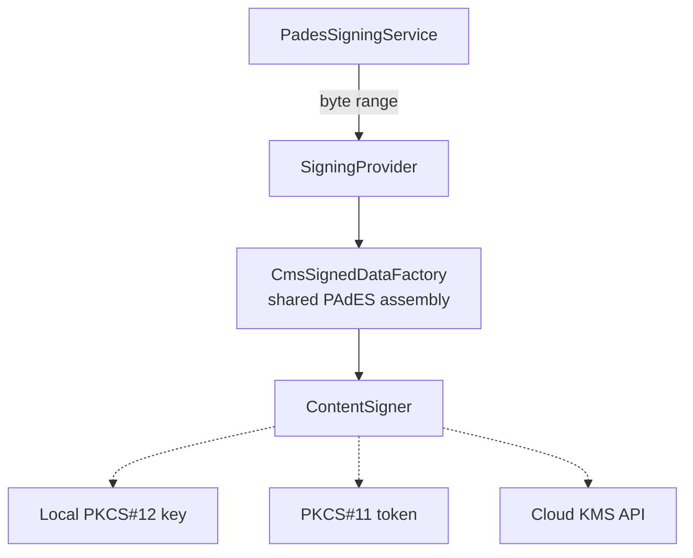

# HSM and Cloud KMS Integration

How a hardware-backed signing provider would plug into DocuTrust, and why the interface is
shaped the way it is.

**Nothing in this document is implemented.** These are designed extension points, described
so the path is concrete — not stubs pretending to work.

---

## The problem with a key in a file

The development build loads a private key from a PKCS#12 file into process memory. That is
acceptable for a local demonstration and unacceptable for signing of consequence:

- Anyone who reads the file and its password can sign as you, indefinitely.
- A memory disclosure bug can expose the key.
- Key use is unauditable — you cannot tell how many signatures a stolen copy produced.
- It materially weakens non-repudiation. A signer can plausibly argue the key was copied,
  because it genuinely could have been.

An HSM or cloud KMS inverts this. The key is generated **inside** the device and never
leaves it. You send bytes in and get a signature back. There is no export API. Compromising
the application server no longer means compromising the key: an attacker can sign only
while they retain access, and every use is logged independently of the application.

---

## Why `SigningProvider` looks like this

```java
public interface SigningProvider {
    SignResult sign(SignRequest request);
    String providerName();
    X509Certificate[] certificateChain();
    boolean isAvailable();
}
```

The interface deliberately **never exposes a `PrivateKey`**.

This is the single design decision that makes hardware backing possible. The obvious
alternative — a `KeyProvider` returning a `PrivateKey` — is a dead end, because AWS KMS,
Azure Key Vault, Google Cloud KMS and every HSM exist precisely so the key cannot be
exported. Any such provider would have to weaken its security model or fail to implement
the interface at all.

Getting this wrong early would mean reworking every call site later. See
[ADR-004](ADR/ADR-004-signing-provider-abstraction.md).

---

## What a new provider must supply

Only two things:

1. **A raw signature** over a digest, produced by the device.
2. **The certificate chain** corresponding to that key.

CMS assembly is already shared in `CmsSignedDataFactory`, so providers cannot drift into
emitting structurally different signatures. A provider supplies a Bouncy Castle
`ContentSigner` that delegates the signature operation to the device, and reuses everything
else.



---

## SoftHSM (PKCS#11)

The cheapest route to validating the design, because it is a real PKCS#11 implementation
that runs locally.

The JDK's `SunPKCS11` provider exposes a token as a normal `KeyStore`, where
`getKey()` returns a **handle** rather than exportable key material. `Signature` operations
on that handle execute inside the token. A provider would configure `SunPKCS11` against
the token's library path and slot, then build a `ContentSigner` over that handle.

Worth doing first: if the abstraction survives PKCS#11, it will survive the cloud APIs.

---

## AWS KMS

KMS has no JCA provider. The provider would:

1. Compute the SHA-256 digest of the byte range locally.
2. Call `Sign` with `MessageType: DIGEST` and `SigningAlgorithm: RSASSA_PKCS1_V1_5_SHA_256`
   (or an ECDSA equivalent).
3. Wrap the returned signature in a `ContentSigner` whose `getOutputStream()` collects the
   content and whose `getSignature()` returns the KMS result.

The certificate is **not** in KMS — KMS holds keys, not certificates. The chain must be
configured separately, typically from AWS Private CA or an organisational CA that certified
the KMS public key.

Practical considerations: KMS is a network call on the signing path, so it needs a timeout
and must sit outside any database transaction (DocuTrust already structures signing this
way). It is billed per operation and rate-limited. IAM should grant `kms:Sign` and nothing
else — in particular not `kms:ScheduleKeyDeletion`.

## Azure Key Vault and Google Cloud KMS

The same shape. Azure's `CryptographyClient.signData` and Google's
`AsymmetricSign` both accept a digest and return a signature. Both keep the private key
inside the service. Both need the certificate chain configured separately.

---

## India eSign

`IndiaESignProvider` is named in the specification and is **deliberately not implemented**.

India's eSign framework works differently from the providers above: signing is performed by
a licensed eSign Service Provider after Aadhaar-based or DSC-based authentication of the
signer, and the application never holds a key at all. Integration requires a commercial
relationship with a licensed ESP, conformance to CCA India specifications, and handling of
personally identifiable authentication data.

It cannot be meaningfully stubbed. A placeholder that produced a locally-signed document
labelled "eSign" would be a false claim of legal compliance, which is precisely what the
specification forbids. It stays unimplemented and clearly named as such until a legitimate
integration exists.

---

## Configuration shape

Provider selection is already externalised:

```properties
docutrust.signing.provider=pkcs12     # pkcs12 | pkcs11 | aws-kms | azure-kv | gcp-kms
```

`CryptoConfiguration.signingMaterial` switches on this value. Adding a provider means
adding a branch and a class; no business logic changes.

Cloud credentials must never be required for local development — the `local` profile must
continue to work with a generated PKI and no network access.

---

## Migration path

1. Implement `SoftHsmSigningProvider` and validate the abstraction against real PKCS#11.
2. Implement one cloud provider end to end, including certificate chain configuration.
3. Add health checks so an unreachable KMS surfaces at startup rather than on first signature.
4. Add metrics for signing latency — a network-backed signer changes the performance
   profile substantially.
5. Only then consider PAdES B-LT/B-LTA, which need embedded revocation data and a TSA.
