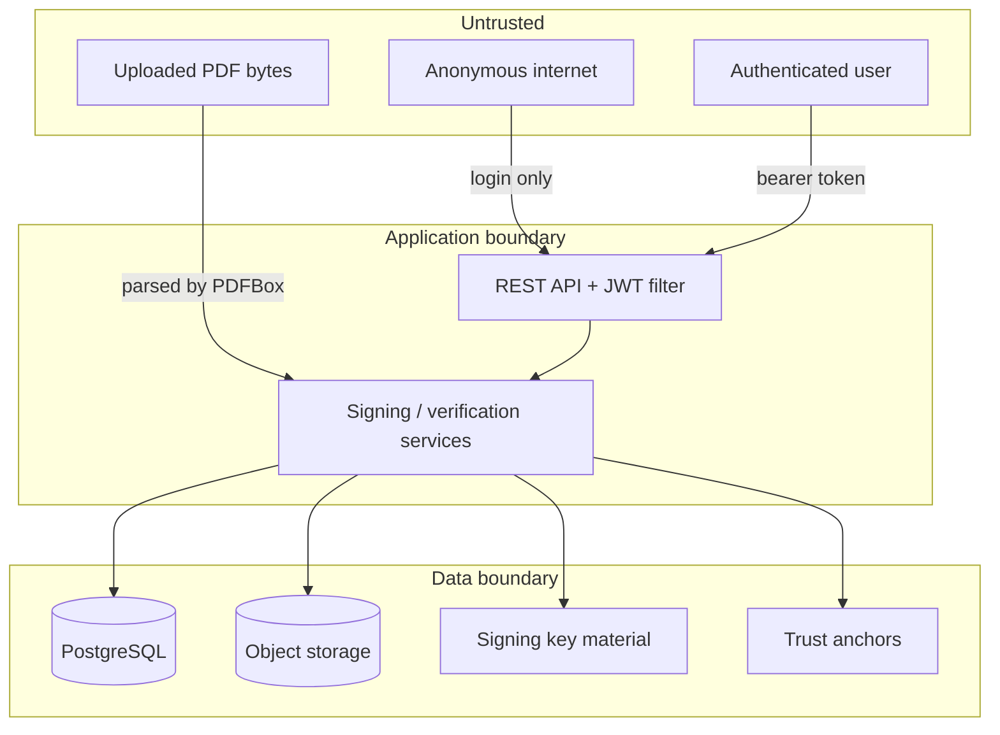

# DocuTrust — Threat Model (STRIDE)

Scope: the DocuTrust backend, frontend, storage and PKI configuration as implemented in
this repository.

Each threat states the attack, the mitigation **as actually built**, and the **residual
risk** that remains. The residual risk column is the useful part — a threat model listing
only mitigations is marketing.

---

## Trust boundaries

The most dangerous boundary is **uploaded PDF bytes reaching a parser**. That is
attacker-controlled input processed by a large, complex library.

---

## S — Spoofing

### S1. Attacker forges a document appearing to come from a legitimate signer

*Attack.* Create a convincing contract, sign it with a self-signed certificate whose
subject reads `CN=Northwind Textiles`, and present it as authentic.

*Mitigation.* Trust is established only through configured trust anchors
(`TrustAnchorProvider`). The embedded chain is treated as a claim. A self-signed signature
verifies cryptographically but is reported **VALID_UNTRUSTED** (amber) with the chain
status `UNTRUSTED` — never green. Covered by
`DigitalSignatureAttackSuiteTest.untrustedCertificateIsNotTrusted`.

*Residual risk.* A user who ignores the amber state and treats "the signature verified" as
"the document is genuine" is still fooled. The UI makes the distinction prominent, but it
cannot force anyone to read it. If a trusted CA is itself compromised or mis-issues a
certificate, DocuTrust will report the result as trusted — this is an inherent property of
PKI, not a defect here.

### S2. Attacker presents someone else's certificate with their own signature

*Attack.* Sign with key A, embed certificate B, hoping the verifier reports B as the signer.

*Mitigation.* Verification checks the signature against the **public key of the embedded
signer certificate**. A mismatch fails. Additionally the PAdES `signing-certificate-v2`
signed attribute binds the signature to a specific certificate hash. Covered by
`wrongSigningKeyIsDetected`, which asserts `INVALID` with integrity still `INTACT`.

*Residual risk.* None known for this specific substitution.

### S3. Credential theft / session hijack

*Mitigation.* BCrypt strength 12; JWT signed with HS256 over a secret of at least 32
bytes, refused at startup if shorter. Login failures return one message regardless of
cause, and a dummy BCrypt comparison runs when the account does not exist so timing does
not reveal which emails are registered.

*Residual risk.* **Significant.** The token is held in `localStorage`, so any XSS flaw
exposes it. There is no token revocation list, so a stolen token is valid until it
expires (default 60 minutes). Login is rate limited per source address, which bounds online
password guessing, though there is no multi-factor authentication.

---

## T — Tampering

### T1. Attacker modifies a signed PDF

*Attack.* Change `INR 800,000` to `INR 900,000` in a signed contract, preserving length so
every byte offset stays valid and the file still opens.

*Mitigation.* The digest is recomputed over the signature's `/ByteRange` and compared with
the digest sealed in the signed attributes. A mismatch is **cryptographic proof** of
modification. Reported as `TAMPERED`, integrity `MODIFIED`, classification
`SIGNED_CONTENT_CHANGED`, `cryptographicallyProven = true`. This exact attack is executed
in `SignAndVerifyTest.tamperingIsDetected` and by `scripts/demo-flow.ps1`.

*Residual risk.* None for content covered by the signature. Content **appended after** a
signature is a different case: the earlier signature still verifies over what it covers,
and DocuTrust reports `POST_SIGNATURE_INCREMENTAL_UPDATE` without calling it tampering —
because legitimate counter-signatures work exactly that way. A reader who only glances at
the top-level verdict could miss that the visible document differs from the signed
revision.

### T2. Attacker edits the audit log to erase their tracks

*Mitigation.* Each record's SHA-256 covers the previous record's hash plus its own
canonical contents. Editing, deleting or inserting any entry breaks every subsequent link.
`AuditIntegrityService.verifyChain()` detects all three, and the dashboard surfaces chain
status. The canonical form is length-prefixed so field boundaries cannot be shifted to
produce a colliding hash — tested in `fieldBoundariesCannotBeShifted`.

*Residual risk.* **The chain is tamper-evident, not tamper-proof.** An attacker with full
database write access can recompute the entire chain from their edit onward and leave it
internally consistent. Closing this requires publishing chain-head digests to independent
storage or timestamping them with a TSA; neither is implemented.

### T3. Malicious PDF exploits the parser

*Attack.* Craft a PDF triggering a memory or logic flaw in PDFBox.

*Mitigation.* Uploads are size-limited at both the servlet container and the application
layer, validated by magic bytes rather than the declared `Content-Type`, and structurally
parsed before storage. PDFBox is a memory-safe JVM library, so classic memory-corruption
exploitation does not apply.

*Residual risk.* A parser bug could still cause a denial of service (unbounded allocation,
pathological loop) within the limits set. Parsing happens in the main application process
rather than an isolated sandbox.

---

## R — Repudiation

### R1. A signer denies having signed

*Mitigation.* The signature is produced by a private key bound to an identity by a CA. The
`nonRepudiation` (contentCommitment) key usage is asserted on signer certificates. Every
signing action is recorded in the hash-chained audit log with actor, document, correlation
ID and timestamp.

*Residual risk.* **Substantial, and worth being direct about.** Non-repudiation in any
meaningful legal sense requires more than this build provides:

- Without a **trusted timestamp**, the time of signing cannot be proven. The claimed time
  is the signer's own assertion.
- The signing key is a PKCS#12 file readable by the application. A signer could plausibly
  argue the key was copied, because it genuinely could be. An HSM-held key materially
  strengthens this argument; a file-held key weakens it.
- DocuTrust's own audit log is evidence controlled by the same party running the system.

### R2. An operator denies an administrative action

*Mitigation.* Admin actions are audited with actor and correlation ID.

*Residual risk.* An administrator with database access can alter the chain (see T2).
Separation of duties is not implemented.

---

## I — Information disclosure

### I1. One user reads another user's documents

*Mitigation.* Every document operation goes through
`requireOwnedDocument(documentId, ownerId)`, which scopes the query by owner. A document
belonging to someone else raises the same `DocumentNotFoundException` as one that does not
exist — deliberately identical, so identifiers cannot be enumerated by distinguishing
"forbidden" from "not found".

*Residual risk.* No per-document sharing model exists, so the only granularity is
ownership. The `VERIFIER` and `ADMIN` roles are coarse.

### I2. Secrets leak through logs or error responses

*Mitigation.* Error responses carry a stable code, a message authored for the client, and
a correlation ID — never stack traces, paths, SQL or configuration. Exception detail is
logged server-side instead. `UserEntity.toString()` omits the password hash. The JWT
filter logs only an exception class name, never the token. Hibernate SQL logging is off.
Metric labels exclude filenames.

*Residual risk.* Log discipline is a convention, not an enforced invariant. A future
`log.debug("request {}", request)` could undo it. No automated check prevents that.

### I3. Key material committed to version control

*Mitigation.* `.gitignore` blocks `*.p12`, `*.pfx`, `*.jks`, `*.key`, `*.pem`, `*.der`,
`.env`, and `pki-local/`. No password appears in source; all come from the environment.
Demo passwords are generated at runtime and printed once.

*Residual risk.* `.gitignore` prevents accidents, not deliberate `git add -f`. No secret
scanning runs in CI.

### I4. Documents readable directly from storage

*Residual risk.* Filesystem storage applies no encryption at rest. Anyone with host
filesystem access reads every document. Storage-level encryption is not implemented.

---

## D — Denial of service

### D1. Huge or malicious uploads exhaust resources

*Mitigation.* Container-level (`spring.servlet.multipart.max-file-size`) and
application-level size limits, both defaulting to 25 MB. Hashing streams in 64 KiB chunks
rather than buffering whole files.

*Additional mitigation.* Signing and verification are rate limited per authenticated
account (`RateLimitFilter`), which bounds how much cryptographic and parsing work one
account can demand. Refusals return `429` with `Retry-After`.

*Residual risk.* Signing and verification still load the full PDF into a `byte[]`, because
PDFBox's signing API needs random access to the byte range. Concurrent requests at the size
limit can therefore pressure the heap. A "zip bomb" style PDF with deeply nested or highly
compressed structures could consume disproportionate CPU inside the parser within one
request. The rate limiter is **in-memory and per-instance**, so across several instances
the effective limit multiplies by the instance count; a shared store or an edge-level limit
is required before horizontal scaling.

### D2. Audit append lock contention

*Residual risk.* Appends serialise on a per-JVM lock. Under heavy write load this is a
throughput ceiling. Across multiple instances it is worse than a ceiling — it is
incorrect, and would fork the chain. Database-level serialisation is required before
horizontal scaling.

---

## E — Elevation of privilege

### E1. A `USER` performs an administrative action

*Mitigation.* Spring Security with `@EnableMethodSecurity`. `/api/v1/admin/**` and
`/actuator/**` (beyond health and info) require `ROLE_ADMIN`; upload and sign require
`USER` or `ADMIN`. Authorisation is enforced server-side; the frontend route guard is a
usability affordance only and is documented as such in `App.tsx`.

*Verified by.* `AuthorizationTest` attempts the escalation rather than asserting the
configuration: a `USER` token is used against `/api/v1/admin/**` and `/actuator/prometheus`
and must receive 403; an `ADMIN` token against the same endpoints must succeed; an absent,
malformed, or foreign-signed token must receive 401.

*Residual risk.* Roles remain coarse — there is no per-document sharing model, so the only
granularity below role is ownership.

### E2. Forged or altered JWT

*Mitigation.* Signature, issuer and expiry are all verified. A secret shorter than 32
bytes is refused at startup; outside the `local` profile a missing secret prevents startup
rather than silently generating one.

*Residual risk.* No revocation list, so a leaked token remains valid until expiry.

---

## Summary of the most significant residual risks

Ranked by what a reviewer should worry about first:

1. **Token in `localStorage` with no revocation** — an XSS flaw yields a usable token for
   up to an hour.
2. **Audit chain is evident, not proof** — an attacker with database write access can
   rebuild it consistently.
3. **Signing key in a file** — materially weakens any non-repudiation claim; HSM/KMS is
   designed for but not implemented.
4. **No trusted timestamp** — the time of signing cannot be proven, which limits what a
   signature can establish after certificate expiry.
5. **Rate limiting is per-instance** — correct for one process, but the effective limit
   multiplies across a horizontally scaled deployment.
6. **No encryption at rest** — documents are readable to anyone with host access.
7. **Coarse authorisation** — access control is enforced and tested, but the only
   granularity below role is document ownership; there is no sharing model.
